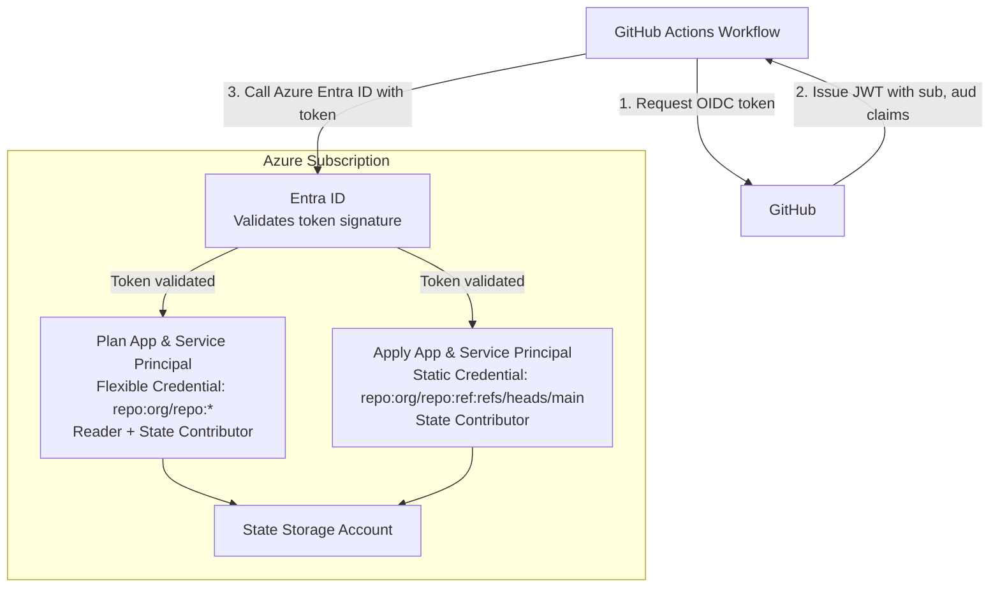

# Azure GitHub Pipelines Bootstrap Stack

> **Deprecated.** [`pipelines-identity`](../pipelines-identity) is an exact copy of this stack under a new name. To switch, change `pipelines-bootstrap` to `pipelines-identity` in your stack's `source`. Nothing else changes. This old stack named `pipelines-bootstrap` will be removed in the next major version.

## Overview

This Terragrunt stack bootstraps Azure infrastructure for GitHub Actions with OIDC authentication. It creates all necessary Azure resources to enable secure, keyless authentication from GitHub Actions workflows to your Azure subscription for [Gruntwork Pipelines](https://www.gruntwork.io/platform/pipelines).

## What This Stack Creates

### OIDC Resources for Plan Operations

- Entra ID Application for plan operations
- Service Principal for the application
- Flexible Federated Identity Credential (allows any branch on a given repository to assume the role)
- Custom role definition with read-only permissions for Azure resources
- Custom role assignment at subscription level
- Microsoft Graph `Application.Read.All` application permission
- Contributor role assignment to state storage account

### OIDC Resources for Apply Operations

- Entra ID Application for apply operations
- Service Principal for the application
- Static Federated Identity Credential (main branch only)
- Custom role definition with full management permissions for bootstrap resources
- Custom role assignment at subscription level
- Microsoft Graph `Application.Read.All` application permission

## Usage

Read the [official Gruntwork Pipelines installation guide](https://docs.gruntwork.io/2.0/docs/pipelines/installation/addingnewrepo) for usage instructions.

## Values

### Required

| Name | Description | Example |
|------|-------------|---------|
| `subscription_id` | ID of the subscription that holds the state storage account | `11111111-1111-1111-1111-111111111111` |
| `state_resource_group_name` | Resource group of the state storage account | `tofu-state-rg` |
| `state_storage_account_name` | Name of the state storage account | `tfstate12345678` |
| `github_org_name` | GitHub organization or username | `my-org` |
| `github_repo_name` | GitHub repository name | `infrastructure` |

### Optional

| Name | Description | Default |
|------|-------------|---------|
| `oidc_resource_prefix` | Prefix for Entra ID resources | `pipelines` |
| `github_token_actions_domain` | GitHub Actions token domain | `token.actions.githubusercontent.com` |
| `github_org_id` | Numeric GitHub organization/user ID. Required for all repos created on or after 2026-07-15 (see [Immutable Subject Claims](#immutable-subject-claims) below); leave blank for existing repos that haven't opted in. Must be set together with `github_repo_id`. | `1234567` |
| `github_repo_id` | Numeric GitHub repository ID. Must be set together with `github_org_id`. | `987654321` |
| `audiences` | OIDC audiences | `["api://AzureADTokenExchange"]` |
| `issuer` | OIDC issuer URL | `https://token.actions.githubusercontent.com` |
| `deploy_branch` | Branch allowed for applies | `main` |
| `plan_service_principal_to_sub_role_definition_assignment` | Role for plan SP at subscription level | `Reader` |
| `plan_service_principal_to_state_role_definition_assignment` | Role for plan SP on state storage | `Contributor` |
| `apply_service_principal_to_state_role_definition_assignment` | Role for apply SP on state storage | `Contributor` |
| `plan_graph_app_roles` | Microsoft Graph application permissions granted to the plan SP | `["Application.Read.All"]` |
| `apply_graph_app_roles` | Microsoft Graph application permissions granted to the apply SP | `["Application.Read.All"]` |

## Stack Architecture



## Federated Credentials

### Plan (Flexible - Any Branch)

Uses a **flexible federated identity credential** with claim matching:

```text
claims['sub'] matches 'repo:my-org/my-repo:*'
```

This allows plans from:

- Any branch
- Pull requests

**Note**: Requires Azure CLI (`az rest` command) due to Beta API usage.

### Apply (Static - Main Branch Only)

Uses a **static federated identity credential** with exact subject:

```text
subject: repo:my-org/my-repo:ref:refs/heads/main
```

This only allows applies from the `main` branch.

## Immutable Subject Claims

GitHub is rolling out an [immutable subject-claim format](https://github.blog/changelog/2026-04-23-immutable-subject-claims-for-github-actions-oidc-tokens/) for Actions OIDC tokens, which embeds numeric, immutable org/repo IDs in the `sub` claim (`repo:org@org_id/repo@repo_id:...`) instead of names alone. **Starting 2026-07-15, this format is required for all newly created GitHub repositories.**

Both the flexible (plan) and static (apply) federated identity credentials above are keyed off the `sub` claim, so both switch to the immutable format together.

To opt in (or if your repo is subject to the new requirement), set both `github_org_id` and `github_repo_id`:

```hcl
values = {
  github_org_name  = "my-org"
  github_repo_name = "infrastructure"
  github_org_id    = "1234567"
  github_repo_id   = "987654321"
}
```

You can look up the numeric IDs with:

```bash
gh api repos/{owner}/{repo} --jq '{owner_id: .owner.id, repo_id: .id}'
```

Leave both values unset to keep the legacy `repo:org/repo:...` format. Both must be set together — setting only one falls back to the legacy format.

## Custom Role Permissions

This stack creates custom Azure RBAC roles for Pipelines: a read-only plan role, and an apply role that covers the bootstrap resources and commonly used services.

### Plan Custom Role (Read-Only)

Permissions granted:

- `*/read` - Read all Azure resources
- `Microsoft.Resources/subscriptions/resourceGroups/read`
- `Microsoft.Resources/deployments/read`
- `Microsoft.Resources/deployments/operations/read`
- `Microsoft.Storage/storageAccounts/listKeys/action` - Access state storage keys
- `Microsoft.Storage/storageAccounts/blobServices/containers/read`

**Purpose**: Generate Terraform plans without making any changes.

### Apply Custom Role (Full Management)

Permissions granted:

- `*/read` - Read all Azure resources
- `Microsoft.Resources/subscriptions/resourceGroups/*` - Manage resource groups
- `Microsoft.Resources/deployments/*` - Manage deployments
- `Microsoft.Storage/storageAccounts/*` - Manage storage accounts and all services
- `Microsoft.Authorization/roleAssignments/*` - Manage role assignments
- `Microsoft.Authorization/roleDefinitions/*` - Manage custom role definitions
- Common workload services:
  - `Microsoft.Compute/*` - Virtual machines, disks, images, scale sets
  - `Microsoft.Network/*` - Virtual networks, NSGs, load balancers, public IPs, private endpoints, Application Gateway, DNS and private DNS zones
  - `Microsoft.ContainerService/*`, `Microsoft.ContainerRegistry/*`, `Microsoft.App/*` - AKS, container registries, Container Apps
  - `Microsoft.Web/*` - App Service and Functions
  - `Microsoft.Sql/*`, `Microsoft.DBforPostgreSQL/*`, `Microsoft.DBforMySQL/*`, `Microsoft.DocumentDB/*`, `Microsoft.Cache/*` - Databases and caches
  - `Microsoft.KeyVault/*` - Key vaults
  - `Microsoft.ServiceBus/*`, `Microsoft.EventHub/*` - Messaging
  - `Microsoft.ManagedIdentity/*` - User-assigned managed identities
  - `Microsoft.Insights/*`, `Microsoft.OperationalInsights/*` - Monitoring, alerts, diagnostic settings, Log Analytics

**Purpose**: Create, update, and destroy the bootstrap resources and the services teams commonly deploy, comparable to the GCP and AWS defaults. Override `apply_custom_role_actions` to narrow or widen it.

### Customizing Permissions

You can override the default permissions by providing custom actions:

```hcl
values = {
  plan_custom_role_actions = [
    "*/read",
    "Microsoft.Compute/virtualMachines/read",
    # Add additional read permissions as needed
  ]

  apply_custom_role_actions = [
    "*/read",
    "Microsoft.Resources/subscriptions/resourceGroups/*",
    "Microsoft.Compute/virtualMachines/*",
    # Add additional permissions as needed
  ]
}
```

### Entra ID Permissions

Azure RBAC custom roles only grant permissions for Azure Resource Manager operations. Entra ID resources (applications, service principals, federated credentials) use Microsoft Graph permissions instead.

**Initial bootstrap**: The user running the stack needs Owner (Azure RBAC) and the **Global Administrator** directory role, or both **Cloud Application Administrator** (to create the applications) and **Privileged Role Administrator** (to grant the Microsoft Graph application permissions below).

**Microsoft Graph application permissions**: The stack grants both service principals `Application.Read.All`, with admin consent. It lets each identity read the other's application, service principal and federated identity credential, so Pipelines can plan and apply this stack after a person applied it. Without it, a Pipelines plan of this stack fails with `403 Authorization_RequestDenied` on the application of the other identity. `Application.Read.All` is read-only, but it reads every application and service principal in the tenant (not client secret values), like the IAM read access the AWS and GCP plan roles have.

Neither identity can change Entra ID resources by default. When a change to this stack touches its applications, service principals, federated identity credentials or Graph permissions, a Global Administrator applies it, for example from their machine. To change the permissions, set `plan_graph_app_roles` or `apply_graph_app_roles`; an empty list grants none. Do not give the plan identity write permissions: it runs on any branch.

**Service principal owners**: The principal that creates a service principal owns it. The stack ignores later changes to owners, so a plan does not change them to whoever runs it.

## Security Considerations

### Branch Protection

The apply role is restricted to the `deploy_branch` (default: `main`). Ensure you have branch protection rules:

- Require pull request reviews
- Require status checks to pass
- Restrict who can push

### Least Privilege

This stack implements least-privilege access through custom roles:

- **Plan role**: Read-only access at subscription level plus scoped Contributor access to state storage only
- **Apply role**: Full management of bootstrap resources at subscription level, scoped to necessary operations
- **No redundant roles**: Built-in Reader and Contributor roles at subscription level have been removed to avoid permission overlap

## Outputs

| Name | Description |
|------|-------------|
| plan_app.client_id | Client ID of the plan application |
| plan_app.id | Object ID of the plan application |
| plan_service_principal.object_id | Object ID of the plan service principal |
| apply_app.client_id | Client ID of the apply application |
| apply_app.id | Object ID of the apply application |
| apply_service_principal.object_id | Object ID of the apply service principal |

## Related Documentation

- [GitHub Actions with Azure](https://learn.microsoft.com/en-us/azure/developer/github/connect-from-azure)
