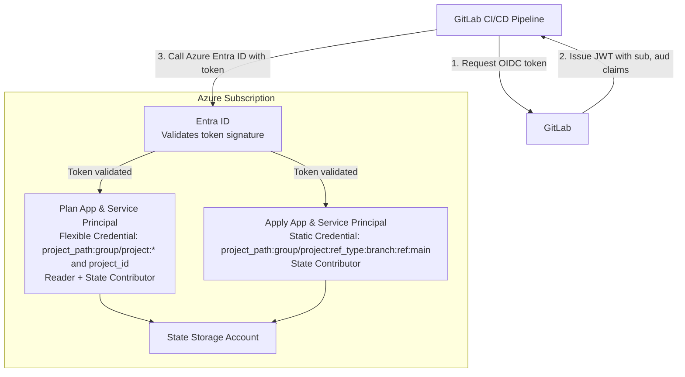

# Azure GitLab Pipelines Bootstrap Stack

> **Deprecated.** [`pipelines-identity`](../pipelines-identity) is an exact copy of this stack under a new name. To switch, change `pipelines-bootstrap` to `pipelines-identity` in your stack's `source`. Nothing else changes. This old stack named `pipelines-bootstrap` will be removed in the next major version.

## Overview

This Terragrunt stack bootstraps Azure infrastructure for GitLab CI/CD with OIDC authentication. It creates all necessary Azure resources to enable secure, keyless authentication from GitLab pipelines to your Azure subscription for [Gruntwork Pipelines](https://www.gruntwork.io/platform/pipelines).

## What This Stack Creates

### OIDC Resources for Plan Operations

- Entra ID Application for plan operations
- Service Principal for the application
- Flexible Federated Identity Credential (allows any branch on a given project to assume the role)
- Custom role definition with read-only permissions for Azure resources
- Custom role assignment at subscription level
- Contributor role assignment to state storage account (scoped for security)
- Optional Management Group Reader and Reader role assignments on management groups (see [Landing-Zone Access](#landing-zone-access))

### OIDC Resources for Apply Operations

- Entra ID Application for apply operations
- Service Principal for the application
- Static Federated Identity Credential (main branch only)
- Custom role definition with full management permissions for bootstrap resources
- Custom role assignment at subscription level
- Optional Management Group Contributor, Resource Policy Contributor and limited Role Based Access Control Administrator role assignments on management groups (see [Landing-Zone Access](#landing-zone-access))

## Usage

Read the [official Gruntwork Pipelines installation guide](https://docs.gruntwork.io/2.0/docs/pipelines/installation/addingnewrepo) for usage instructions.

## Values

### Required

| Name | Description | Example |
|------|-------------|---------|
| `subscription_id` | ID of the subscription that holds the state storage account | `11111111-1111-1111-1111-111111111111` |
| `state_resource_group_name` | Resource group of the state storage account | `tofu-state-rg` |
| `state_storage_account_name` | Name of the state storage account | `tfstate12345678` |
| `gitlab_group_name` | GitLab group name | `my-group` |
| `gitlab_project_name` | GitLab project name | `infrastructure` |
| `gitlab_project_id` | Numeric GitLab project ID. The plan identity's flexible federated identity credential matches the `project_id` claim against it, because Entra ID rejects a GitLab flexible credential that matches only the name-based `sub` claim. Find it on the project's overview page or as `id` from `GET /api/v4/projects/<url-encoded path>`. | `12345678` |

### Optional

| Name | Description | Default |
|------|-------------|---------|
| `oidc_resource_prefix` | Prefix for Entra ID resources | `pipelines` |
| `gitlab_server_domain` | GitLab server domain | `gitlab.com` |
| `audiences` | OIDC audiences | `["api://AzureADTokenExchange"]` |
| `issuer` | OIDC issuer URL | `https://gitlab.com` |
| `deploy_branch` | Branch allowed for applies | `main` |
| `plan_service_principal_to_sub_role_definition_assignment` | Role for plan SP at subscription level | `Reader` |
| `plan_service_principal_to_state_role_definition_assignment` | Role for plan SP on state storage | `Contributor` |
| `apply_service_principal_to_state_role_definition_assignment` | Role for apply SP on state storage | `Contributor` |
| `plan_owners` | Object IDs that own the plan application and service principal | `[]` |
| `apply_owners` | Object IDs that own the apply application and service principal | `[]` |
| `management_group_scope` | Management group whose tree Pipelines manages, usually the tenant root management group. When set, the plan identity gets Management Group Reader and the apply identity Management Group Contributor on it. See [Landing-Zone Access](#landing-zone-access) | `""` |
| `policy_scope` | Management group where Pipelines manages Azure Policy. When set, the plan identity gets Reader and the apply identity Resource Policy Contributor on it | `""` |
| `grantable_role_definition_ids` | Role definition IDs (GUIDs) the apply identity may assign and remove at `policy_scope`, such as the roles policy assignments' managed identities need. When set with `policy_scope`, the apply identity gets Role Based Access Control Administrator there, with a condition that allows only these roles | `[]` |
| `landing_zone_role_assignment_description` | Description of the role assignments above | `Gruntwork Pipelines access to manage the landing zone` |

## Stack Architecture



## Federated Credentials

### Plan (Flexible - Any Branch)

Uses a **flexible federated identity credential** with claim matching:

```text
claims['sub'] matches 'project_path:my-group/my-project:*' and claims['project_id'] eq '12345678'
```

This allows plans from:

- Any branch
- Merge requests

Entra ID rejects a GitLab flexible credential that matches only the `sub` claim, because a project path can be renamed and later reused. The `project_id` claim is assigned once and never reused, so it pins the credential to the original project. See [Mutable subjects in federated identity credentials](https://learn.microsoft.com/en-us/entra/workload-id/workload-identities-federated-credential-mutable-subjects).

**Note**: Requires Azure CLI (`az rest` command) due to Beta API usage.

### Apply (Static - Main Branch Only)

Uses a **static federated identity credential** with exact subject:

```text
subject: project_path:my-group/my-project:ref_type:branch:ref:main
```

This only allows applies from the `main` branch.

## Custom Role Permissions

This stack creates custom Azure RBAC roles for Pipelines: a read-only plan role, and an apply role that covers the bootstrap resources and commonly used services.

### Plan Custom Role (Read-Only)

Permissions granted:

- `*/read` - Read all Azure resources
- `Microsoft.Resources/subscriptions/resourceGroups/read`
- `Microsoft.Resources/deployments/read`
- `Microsoft.Resources/deployments/operations/read`
- `Microsoft.Storage/storageAccounts/blobServices/containers/read`

**Purpose**: Generate Terraform plans without making any changes.

State access comes from the plan identity's role on the state storage account (`plan_service_principal_to_state_role_definition_assignment`, Contributor by default), which covers only that account.

### Apply Custom Role (Full Management)

Permissions granted:

- `*/read` - Read all Azure resources
- `Microsoft.Resources/subscriptions/resourceGroups/*` - Manage resource groups
- `Microsoft.Resources/deployments/*` - Manage deployments
- `Microsoft.Storage/storageAccounts/*` - Manage storage accounts and all services
- `Microsoft.Authorization/roleAssignments/*` - Manage role assignments
- `Microsoft.Authorization/roleDefinitions/*` - Manage custom role definitions
- Common workload services:
  - `Microsoft.Compute/*` - Virtual machines, disks, images, scale sets
  - `Microsoft.Network/*` - Virtual networks, NSGs, load balancers, public IPs, private endpoints, Application Gateway, DNS and private DNS zones
  - `Microsoft.ContainerService/*`, `Microsoft.ContainerRegistry/*`, `Microsoft.App/*` - AKS, container registries, Container Apps
  - `Microsoft.Web/*` - App Service and Functions
  - `Microsoft.Sql/*`, `Microsoft.DBforPostgreSQL/*`, `Microsoft.DBforMySQL/*`, `Microsoft.DocumentDB/*`, `Microsoft.Cache/*` - Databases and caches
  - `Microsoft.KeyVault/*` - Key vaults
  - `Microsoft.ServiceBus/*`, `Microsoft.EventHub/*` - Messaging
  - `Microsoft.ManagedIdentity/*` - User-assigned managed identities
  - `Microsoft.Insights/*`, `Microsoft.OperationalInsights/*` - Monitoring, alerts, diagnostic settings, Log Analytics
- Subscription baseline:
  - `Microsoft.Security/pricings/*`, `Microsoft.Security/securityContacts/*`, `Microsoft.Security/register/action` - Defender for Cloud plans and alert contacts
  - `Microsoft.Consumption/budgets/*`, `Microsoft.Consumption/register/action`, `Microsoft.CostManagement/scheduledActions/*` - Budgets and cost anomaly alerts
  - `Microsoft.Resources/tags/*` - The subscription's own tags

**Purpose**: Create, update, and destroy the bootstrap resources and the services teams commonly deploy, comparable to the GCP and AWS defaults. Override `apply_custom_role_actions` to narrow or widen it.

### Customizing Permissions

You can override the default permissions by providing custom actions:

```hcl
values = {
  plan_custom_role_actions = [
    "*/read",
    "Microsoft.Compute/virtualMachines/read",
    # Add additional read permissions as needed
  ]

  apply_custom_role_actions = [
    "*/read",
    "Microsoft.Resources/subscriptions/resourceGroups/*",
    "Microsoft.Compute/virtualMachines/*",
    # Add additional permissions as needed
  ]
}
```

### Entra ID Permissions

Azure RBAC custom roles only grant permissions for Azure Resource Manager operations. The Entra ID resources in this stack (applications, service principals, federated identity credentials) use Microsoft Graph permissions instead, and neither Pipelines identity has any.

**Who applies this stack**: A **Global Administrator** with Owner (Azure RBAC) on the subscription applies this stack, the first time and for every later change, including changes to roles and scopes.

**Pipelines does not plan or apply this stack**: Pipelines plans pull requests before they are merged, so its plan identity keeps read-only Azure access and no Microsoft Graph permissions. Planning this stack needs more: reading the other identity's application takes the tenant-wide Microsoft Graph `Application.Read.All` permission. Exclude the stack's directory from Pipelines with an [ignore list](https://docs.gruntwork.io/2.0/reference/pipelines/ignore-list) entry, such as `*/_global/bootstrap/**`, and have an administrator plan and apply it. That plan shows any drift.

**Owners**: The applications and service principals have the owners in `plan_owners` and `apply_owners`, and none by default. An owner can add credentials to an identity and sign in as it, and the apply identity can assign roles on the subscription. A plan shows an owner added outside this stack as a change to remove.

## Landing-Zone Access

A landing zone's management groups and Azure Policy sit above any one subscription, so Pipelines needs roles on management groups to manage them. Set `management_group_scope`, `policy_scope` and `grantable_role_definition_ids` in the stack of the subscription whose identities deploy them:

```hcl
values = {
  management_group_scope = "/providers/Microsoft.Management/managementGroups/<tenant ID>"
  policy_scope           = "/providers/Microsoft.Management/managementGroups/<intermediate root>"

  # Monitoring Contributor and Log Analytics Contributor
  grantable_role_definition_ids = [
    "749f88d5-cbae-40b8-bcfc-e573ddc772fa",
    "92aaf0da-9dab-42b6-94a3-d43ce8d16293",
  ]
}
```

These role assignments are in the `oidc/plan/landing-zone-role-assignments` and `oidc/apply/landing-zone-role-assignments` units, which make no assignments when the values are unset. The management groups must exist before these units apply, so create them first, or leave these units out of the stack's first apply with a filter such as `--filter '<stack directory>/** | !**/landing-zone-role-assignments'`.

The apply identity's Role Based Access Control Administrator assignment carries this condition, version 2.0, with `<IDs>` the comma-separated `grantable_role_definition_ids`:

```text
((!(ActionMatches{'Microsoft.Authorization/roleAssignments/write'})) OR (@Request[Microsoft.Authorization/roleAssignments:RoleDefinitionId] ForAnyOfAnyValues:GuidEquals {<IDs>})) AND ((!(ActionMatches{'Microsoft.Authorization/roleAssignments/delete'})) OR (@Resource[Microsoft.Authorization/roleAssignments:RoleDefinitionId] ForAnyOfAnyValues:GuidEquals {<IDs>}))
```

**Adopting existing assignments**: when the identity already has one of these roles at the same scope, for example from an earlier `az role assignment create`, the next plan imports it instead of creating another. Keep `landing_zone_role_assignment_description` equal to the existing assignment's description, or the plan changes it. Applying these units needs permission to assign roles at the management group scopes, such as User Access Administrator or Owner.

## Security Considerations

### Branch Protection

The apply role is restricted to the `deploy_branch` (default: `main`). Ensure you have branch protection rules:

- Require merge request approvals
- Require pipeline to succeed
- Restrict who can push

### Least Privilege

This stack implements least-privilege access through custom roles:

- **Plan role**: Read-only access at subscription level plus scoped Contributor access to state storage only
- **Apply role**: Full management of bootstrap resources at subscription level, scoped to necessary operations
- **No redundant roles**: Built-in Reader and Contributor roles at subscription level have been removed to avoid permission overlap

## Outputs

| Name | Description |
|------|-------------|
| plan_app.client_id | Client ID of the plan application |
| plan_app.id | Object ID of the plan application |
| plan_service_principal.object_id | Object ID of the plan service principal |
| apply_app.client_id | Client ID of the apply application |
| apply_app.id | Object ID of the apply application |
| apply_service_principal.object_id | Object ID of the apply service principal |

## Related Documentation

- [GitLab CI/CD with Azure](https://docs.gitlab.com/ee/ci/cloud_deployment/#configure-openid-connect-with-azure)
