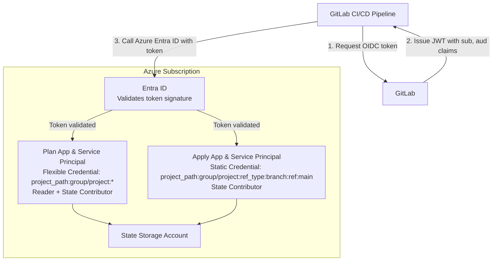

# Azure GitLab Pipelines Bootstrap Stack

## Overview

This Terragrunt stack bootstraps Azure infrastructure for GitLab CI/CD with OIDC authentication. It creates all necessary Azure resources to enable secure, keyless authentication from GitLab pipelines to your Azure subscription for [Gruntwork Pipelines](https://www.gruntwork.io/platform/pipelines).

## What This Stack Creates

### OIDC Resources for Plan Operations

- Entra ID Application for plan operations
- Service Principal for the application
- Flexible Federated Identity Credential (allows any branch on a given project to assume the role)
- Custom role definition with read-only permissions for Azure resources
- Custom role assignment at subscription level
- Contributor role assignment to state storage account (scoped for security)

### OIDC Resources for Apply Operations

- Entra ID Application for apply operations
- Service Principal for the application
- Static Federated Identity Credential (main branch only)
- Custom role definition with full management permissions for bootstrap resources
- Custom role assignment at subscription level

## Usage

Read the [official Gruntwork Pipelines installation guide](https://docs.gruntwork.io/2.0/docs/pipelines/installation/addingnewrepo) for usage instructions.

## Values

### Required

| Name | Description | Example |
|------|-------------|---------|
| `subscription_id` | ID of the subscription that holds the state storage account | `11111111-1111-1111-1111-111111111111` |
| `state_resource_group_name` | Resource group of the state storage account | `tofu-state-rg` |
| `state_storage_account_name` | Name of the state storage account | `tfstate12345678` |
| `gitlab_group_name` | GitLab group name | `my-group` |
| `gitlab_project_name` | GitLab project name | `infrastructure` |

### Optional

| Name | Description | Default |
|------|-------------|---------|
| `terragrunt_scale_catalog_url` | URL of this catalog | `github.com/gruntwork-io/terragrunt-scale-catalog` |
| `terragrunt_scale_catalog_ref` | Git ref to use | `main` |
| `oidc_resource_prefix` | Prefix for Entra ID resources | `pipelines` |
| `gitlab_server_domain` | GitLab server domain | `gitlab.com` |
| `audiences` | OIDC audiences | `["api://AzureADTokenExchange"]` |
| `issuer` | OIDC issuer URL | `https://gitlab.com` |
| `deploy_branch` | Branch allowed for applies | `main` |
| `plan_service_principal_to_sub_role_definition_assignment` | Role for plan SP at subscription level | `Reader` |
| `plan_service_principal_to_state_role_definition_assignment` | Role for plan SP on state storage | `Contributor` |
| `apply_service_principal_to_state_role_definition_assignment` | Role for apply SP on state storage | `Contributor` |

## Stack Architecture



## Federated Credentials

### Plan (Flexible - Any Branch)

Uses a **flexible federated identity credential** with claim matching:

```text
claims['sub'] matches 'project_path:my-group/my-project:*'
```

This allows plans from:

- Any branch
- Merge requests

**Note**: Requires Azure CLI (`az rest` command) due to Beta API usage.

### Apply (Static - Main Branch Only)

Uses a **static federated identity credential** with exact subject:

```text
subject: project_path:my-group/my-project:ref_type:branch:ref:main
```

This only allows applies from the `main` branch.

## Custom Role Permissions

This stack creates custom Azure RBAC roles that provide least-privilege access for ongoing maintenance of bootstrap resources.

### Plan Custom Role (Read-Only)

Permissions granted:

- `*/read` - Read all Azure resources
- `Microsoft.Resources/subscriptions/resourceGroups/read`
- `Microsoft.Resources/deployments/read`
- `Microsoft.Resources/deployments/operations/read`
- `Microsoft.Storage/storageAccounts/listKeys/action` - Access state storage keys
- `Microsoft.Storage/storageAccounts/blobServices/containers/read`

**Purpose**: Generate Terraform plans without making any changes.

### Apply Custom Role (Full Management)

Permissions granted:

- `*/read` - Read all Azure resources
- `Microsoft.Resources/subscriptions/resourceGroups/*` - Manage resource groups
- `Microsoft.Resources/deployments/*` - Manage deployments
- `Microsoft.Storage/storageAccounts/*` - Manage storage accounts and all services
- `Microsoft.Authorization/roleAssignments/*` - Manage role assignments
- `Microsoft.Authorization/roleDefinitions/*` - Manage custom role definitions

**Purpose**: Create, update, and destroy all bootstrap stack resources.

### Customizing Permissions

You can override the default permissions by providing custom actions:

```hcl
values = {
  plan_custom_role_actions = [
    "*/read",
    "Microsoft.Compute/virtualMachines/read",
    # Add additional read permissions as needed
  ]

  apply_custom_role_actions = [
    "*/read",
    "Microsoft.Resources/subscriptions/resourceGroups/*",
    "Microsoft.Compute/virtualMachines/*",
    # Add additional permissions as needed
  ]
}
```

### Entra ID Permissions

**Important**: Azure RBAC custom roles only grant permissions for Azure Resource Manager operations. To manage Entra ID resources (applications, service principals, federated credentials), the user or system performing the bootstrap must have appropriate **Azure AD directory roles** assigned:

- **Application Administrator** - Minimum required role
- **Cloud Application Administrator** - Alternative role
- **Global Administrator** - Full access (use sparingly)

These directory roles must be assigned manually by a Global Administrator and are **separate from Azure RBAC roles**.

**During Initial Bootstrap**: The user running the stack needs Owner (Azure RBAC) + Application Administrator (Directory Role).

**For Ongoing Maintenance**: The service principals will have:

- Azure resources: Managed via custom RBAC roles (sufficient for all Azure RM resources)
- Entra ID resources: Require directory role assignment (must be granted separately)

## Security Considerations

### Branch Protection

The apply role is restricted to the `deploy_branch` (default: `main`). Ensure you have branch protection rules:

- Require merge request approvals
- Require pipeline to succeed
- Restrict who can push

### Least Privilege

This stack implements least-privilege access through custom roles:

- **Plan role**: Read-only access at subscription level plus scoped Contributor access to state storage only
- **Apply role**: Full management of bootstrap resources at subscription level, scoped to necessary operations
- **No redundant roles**: Built-in Reader and Contributor roles at subscription level have been removed to avoid permission overlap

## Outputs

| Name | Description |
|------|-------------|
| plan_app.client_id | Client ID of the plan application |
| plan_app.id | Object ID of the plan application |
| plan_service_principal.object_id | Object ID of the plan service principal |
| apply_app.client_id | Client ID of the apply application |
| apply_app.id | Object ID of the apply application |
| apply_service_principal.object_id | Object ID of the apply service principal |

## Related Documentation

- [GitLab CI/CD with Azure](https://docs.gitlab.com/ee/ci/cloud_deployment/#configure-openid-connect-with-azure)
